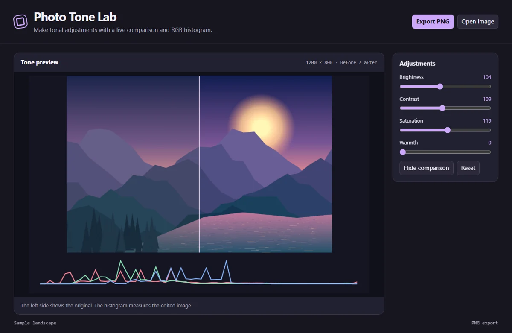

# Photo Tone Lab

Edit brightness, contrast, saturation, and warmth with a split preview, live RGB histogram, and PNG export.



## Run locally

Install Node.js 24 and npm. From the repository directory, run:

```sh
npm ci
npm start
```

The first command installs the locked dependencies. The second opens the desktop window and may download the pinned Electron runtime on first launch. All artwork is processed locally. The app requires no account or API key.

## Use the app

Open a local raster image or use the sample illustration. Adjust brightness, contrast, saturation, and the sepia-based warmth effect. Toggle the comparison to view the full edited frame. Reset restores the starting settings. Export saves the edited raster without guides or histogram.

Images larger than 2400 pixels on their longest side are scaled on import. Export is PNG without source metadata.

## Project layout

- `main.cjs` creates the Electron window and handles native export dialogs.
- `preload.cjs` exposes the small set of desktop operations available to the renderer.
- `app.js` manages shared controls, canvas input, and export encoding.
- `tool.js` contains this app's drawing and editing logic.

## Verify

```sh
npm test
```

The test starts an offscreen Electron window, changes a real editor control, verifies the resulting artwork, and checks the encoded export. On a headless Linux host with Xvfb, use `xvfb-run -a npm test`.
